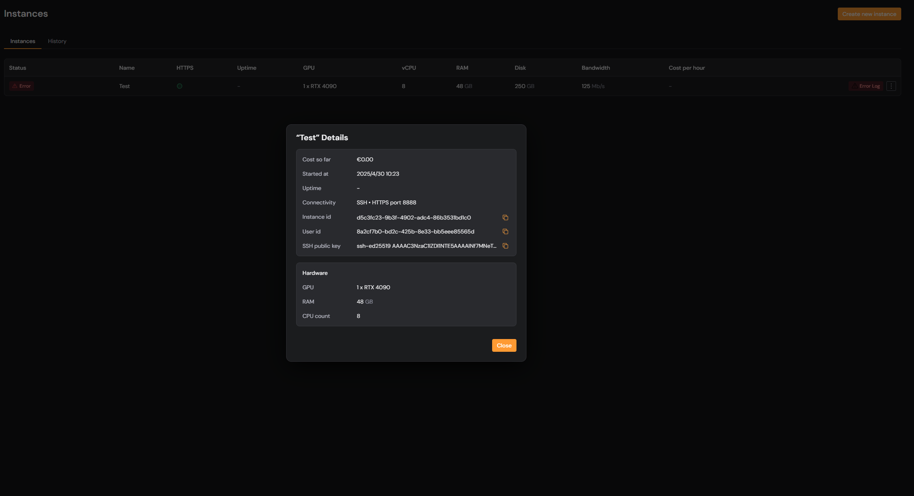

## What you’ll need

- A Compute instance in **Running**, which means it has responded over SSH
- Your SSH private key
- Windows Terminal or another SSH-capable terminal (like PowerShell)
- A configured `config` file (optional but helpful)

## Step 1 – Open the SSH connection details

Open the running instance in **Connectivity options → SSH** on your Windows computer. Copy its current command or SSH configuration block. The console selects the proxy command for the computer you use to view the panel.



## Step 2 – Connect

**Fastest option (recommended)**

1. In the dashboard go to **Instance → Connectivity options → SSH**.
2. Click **Copy to terminal to connect**.
3. Paste the command into your terminal and hit Enter.
   - Keep the supplied connection options. Adjust the private-key path after `-i` to match your local key.
   - If the command uses an SSH alias, add the console’s matching SSH config snippet first.


If the command contains `connect -H`, Windows OpenSSH needs the `connect` HTTP proxy helper on your PATH. Run `Get-Command connect` in PowerShell to check. Keep the proxy host and port after `-H`. If the console gives you a direct connection, keep the port after `-p`. For a container, keep the supplied bastion command.

For a saved connection, copy the console’s entire block to your OpenSSH config file and set `IdentityFile` to your private-key path. If you name the entry `hivenet`, connect with:

```powershell
ssh hivenet
```

## Step 3 – Verify the server identity

If the VM panel shows an `@cert-authority` line, add the complete line to `known_hosts` in your user’s `.ssh` folder. It lets OpenSSH verify VM certificates signed by that authority for the specified hostnames.

If the client asks you to accept a host identity or reports that it has changed, verify it before continuing. See [SSH configuration and host verification](/tutorials/more-guides/SSH-config-file-explained).

## Step 4 – Confirm your connection

If everything works, you'll land in a Linux shell on your instance. You can now:

- Install packages
- Clone repos
- Run workloads
- Start your apps (like Fooocus, Jupyter, etc.)

## Troubleshooting

- **Terminal closes immediately** — Run your SSH command from an open terminal window instead of double-clicking a file.
- **Connection timed out** — Add `-v` to get detailed output and check for network issues.
- **Permission denied** — Check that your SSH key matches what you uploaded in the Compute dashboard.
- **Bad Gateway** — You may be trying to access a web app before it’s started. Use `curl localhost:<port>` to confirm it's running.
